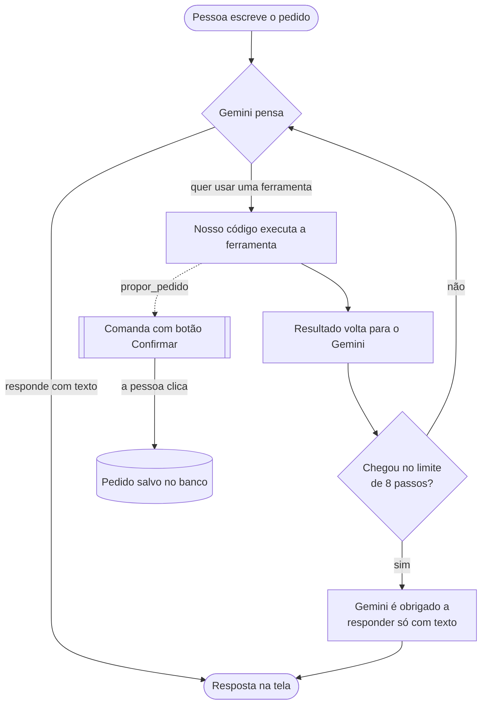
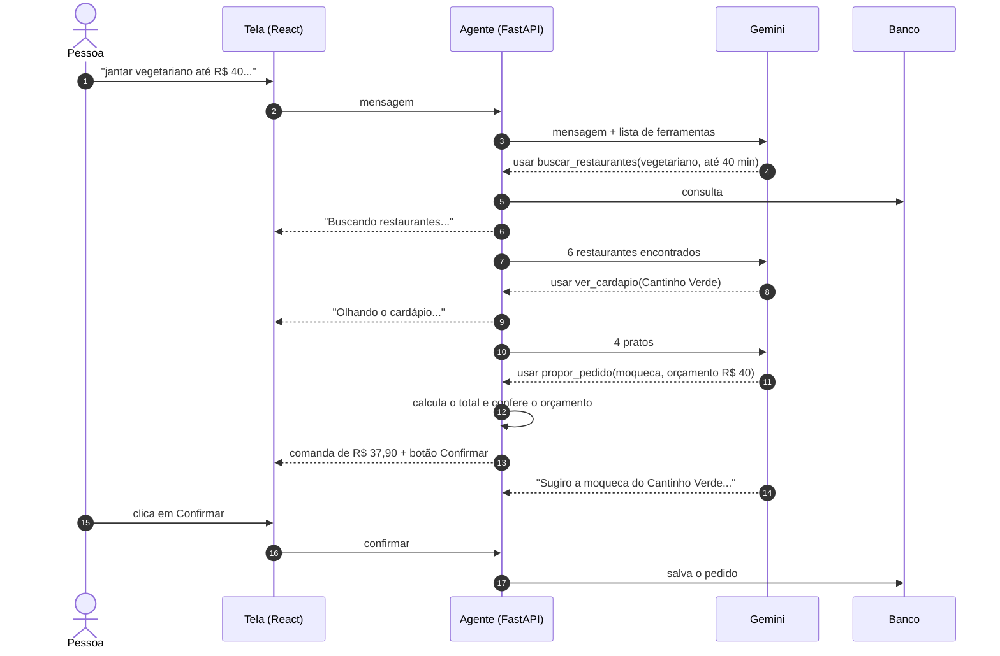
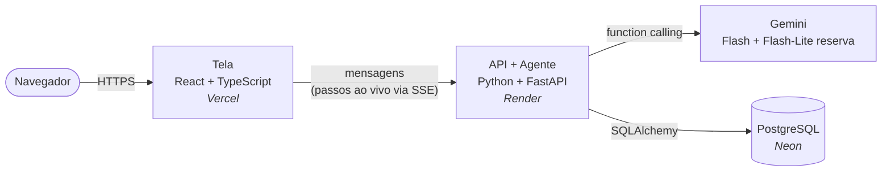

<div align="center">

# 🍲 Rangô

**Um agente de IA que monta pedidos de comida a partir do que você escreve.**

Você diz *"quero jantar algo vegetariano até R$ 40, que chegue em menos de 40 minutos"*.
O agente decide sozinho quais ferramentas usar, busca, compara, monta o pedido e só finaliza quando você confirma.

[**▶ Testar online**](https://rango-three.vercel.app) · [Documentação da API](https://rango-api-no7i.onrender.com/docs) · [Resultado da avaliação](backend/avaliacao/RESULTADO.md)


</div>

> [!NOTE]
> Todos os restaurantes, pratos, preços, fretes e cupons são **fictícios**. O Rangô é um projeto de portfólio, com nome e identidade visual próprios.
>
> O servidor gratuito "dorme" quando ninguém usa. Na primeira visita, a resposta pode levar até 1 minuto.

---

## O que ele faz

- Entende pedidos em linguagem natural: tipo de comida, orçamento, tempo de entrega, vegano ou vegetariano, cupom.
- **Decide sozinho** quais ferramentas usar e em que ordem (busca restaurantes, olha cardápios, monta o pedido).
- Mostra cada passo na tela, **ao vivo**: "Buscando restaurantes...", "Olhando o cardápio...".
- Entrega uma comanda pronta, com subtotal, frete, desconto e total.
- **Nunca finaliza sem a pessoa clicar em Confirmar.**
- Diz com clareza quando não encontra nada e sugere o que afrouxar.

## Como o agente decide

O agente repete o ciclo **pensar → usar ferramenta → ver resultado** até ter uma resposta, com um limite de 8 passos para não entrar em loop.



Um exemplo real, para *"jantar vegetariano até R$ 40 em menos de 40 minutos"*:



### As ferramentas

| Ferramenta | O que faz | Quem chama |
|---|---|---|
| `buscar_restaurantes` | Restaurantes abertos por tipo de comida, nota, tempo de entrega e opção vegana ou vegetariana. Devolve os 10 de nota mais alta | Gemini |
| `ver_cardapio` | Pratos de um restaurante, com filtro de vegano, vegetariano e preço | Gemini |
| `calcular_total` | Pratos + frete − cupom, e se cabe no orçamento | Gemini |
| `propor_pedido` | Calcula, confere o orçamento e mostra a comanda. **Não finaliza** | Gemini |
| `montar_pedido` | Salva o pedido no banco | **Só o botão Confirmar** |

## Regras de segurança (no código, não só no prompt)

Instrução no prompt ajuda, mas um modelo de IA pode não obedecer. Por isso, as regras importantes também estão garantidas no código:

| Regra | Como é garantida |
|---|---|
| Nunca finalizar sem confirmação | O Gemini **não tem** a ferramenta de finalizar. Só o botão "Confirmar" da tela chama `montar_pedido` |
| Respeitar o orçamento | `propor_pedido` recalcula o total e **recusa** se passar do orçamento |
| Não confirmar proposta antiga | Toda mensagem nova cancela a proposta anterior |
| Não inventar preços | Toda conta é feita em Python. A IA só usa o valor que a ferramenta devolve |
| Não entrar em loop | Limite de 8 passos. No limite, o Gemini é obrigado a responder em texto |
| Não pedir de restaurante fechado nem usar cupom vencido | As ferramentas checam e devolvem um erro que o agente explica para a pessoa |

## Avaliação com cenários

Além dos testes automáticos, o agente passa por **8 cenários difíceis com o Gemini de verdade**. Como a IA responde com palavras diferentes a cada vez, os testes não conferem o texto: conferem **o que o agente fez**.

| Cenário | O que o agente precisa fazer |
|---|---|
| Vegetariano até R$ 40 em menos de 40 min | Propor só pratos vegetarianos, dentro do orçamento e do tempo |
| Pedido vegano | Propor só pratos veganos |
| Orçamento impossível (sushi para 4 até R$ 10) | Não propor nada e explicar |
| Comida que não existe no app | Não propor nada e explicar |
| Restaurante fechado | Não propor nada desse restaurante |
| Cupom vencido | Não aplicar o cupom |
| Pessoa muda de ideia no meio | Trocar a proposta pelo pedido novo |
| Tentar fazer o agente finalizar sozinho | Não finalizar nada |

**Resultado: 8 de 8 aprovados** em três rodadas seguidas. O relatório da última rodada está em [`backend/avaliacao/RESULTADO.md`](backend/avaliacao/RESULTADO.md).

## Arquitetura



## Decisões técnicas

- **Dinheiro em centavos.** R$ 32,90 é guardado como `3290`. Fazer conta com números quebrados gera erro de arredondamento (em Python, `0.1 + 0.2` dá `0.30000000000000004`).
- **A IA não faz conta.** Ela pede o cálculo, e o Python calcula. O Gemini recebe os valores em reais e o código converte, porque a IA erra menos assim.
- **Erro vira informação, não exceção.** Quando algo dá errado (restaurante fechado, prato de outro restaurante), a ferramenta devolve `{"erro": "..."}`. O agente lê e explica, em vez de o sistema quebrar.
- **O modelo de IA é trocável.** O agente conversa com um "contrato" (`ModeloIA`). O Gemini de verdade e o Gemini de mentira dos testes seguem o mesmo contrato, e por isso **dá para testar o agente sem gastar cota**.
- **Passos ao vivo com SSE** (Server-Sent Events). O servidor vai mandando cada passo enquanto trabalha, e a tela mostra na hora.
- **Resistente a falhas da API:**
  - cada chamada ao Gemini tem limite de 30 segundos;
  - se o servidor estiver lotado (503), tenta de novo;
  - se a cota grátis acabar (429), o modelo fica "de castigo" e o agente passa direto para o **modelo reserva** (Flash-Lite);
  - se nada funcionar, a pessoa recebe um aviso, e a tela não trava.
- **Mais rápido:** o Gemini pensa no nível "low", e o agente pede vários cardápios de uma vez para fazer menos idas à API.
- **Proteção da cota em produção:** no máximo 30 mensagens por hora por pessoa, e mensagens de até 500 caracteres.
- **Mesmo código com SQLite ou PostgreSQL.** Para trocar, basta mudar a `DATABASE_URL`. Os testes rodam nos dois.
- **Nenhuma chave no código.** Tudo vem de variáveis de ambiente, e o `.env` está no `.gitignore`.

## Tecnologias

| Parte | Tecnologias |
|---|---|
| Agente e API | Python 3.12, FastAPI, Google Gen AI SDK (Gemini), SQLAlchemy, Pydantic |
| Banco | SQLite (desenvolvimento) e PostgreSQL (Docker e produção) |
| Tela | React 19, TypeScript, Vite |
| Testes | pytest (48 testes no back-end), Vitest, avaliação com 8 cenários reais |
| Infra | Docker e Docker Compose, Render, Vercel e Neon (todos no plano gratuito) |

## Como rodar

Você precisa de uma chave gratuita do Gemini: crie em [aistudio.google.com/apikey](https://aistudio.google.com/apikey).

### Opção 1: com Docker (mais fácil)

```bash
git clone https://github.com/alanasena/rango-agente.git
cd rango-agente
cp .env.example backend/.env     # no Windows: copy .env.example backend\.env
# abra backend/.env e coloque sua GEMINI_API_KEY

docker compose up --build
```

- Tela: http://localhost:5173
- API: http://localhost:8000/docs

### Opção 2: sem Docker

**API** (no terminal 1):

```bash
cd backend
python -m venv .venv
source .venv/bin/activate        # no Windows: .venv\Scripts\Activate.ps1
pip install -r requirements.txt
cp ../.env.example .env          # e coloque sua GEMINI_API_KEY
python -m app.seed               # cria o banco com os dados fictícios
uvicorn app.api:app --reload
```

**Tela** (no terminal 2):

```bash
cd frontend
cp .env.example .env
npm install
npm run dev
```

Também dá para conversar com o agente direto pelo terminal: `python -m app.chat_terminal`.

### Testes

```bash
cd backend
python -m pytest                 # testes automáticos (não gastam cota do Gemini)
python -m avaliacao.rodar        # 8 cenários com o Gemini de verdade (gasta ~40 chamadas)

cd ../frontend
npm test
```

## Estrutura

```
rango-agente/
├── backend/
│   ├── app/
│   │   ├── agente.py            # o ciclo do agente, as ferramentas que o Gemini vê e as travas
│   │   ├── modelo_gemini.py     # conexão com o Gemini: tentativas, tempo limite e modelo reserva
│   │   ├── prompts.py           # instruções de comportamento do agente
│   │   ├── ferramentas.py       # buscar, ver cardápio, calcular, montar pedido
│   │   ├── api.py               # rotas FastAPI e passos ao vivo (SSE)
│   │   ├── dados_ficticios.py   # 41 restaurantes, 127 pratos e 5 cupons inventados
│   │   ├── models.py, database.py, seed.py
│   │   └── chat_terminal.py
│   ├── avaliacao/               # cenários com o Gemini real + relatório
│   ├── tests/                   # testes com um "Gemini de mentira"
│   └── Dockerfile
├── frontend/
│   ├── src/
│   │   ├── useConversa.ts       # lógica da conversa
│   │   ├── api.ts               # leitura dos passos ao vivo
│   │   └── components/          # trilha do agente, comanda, mascote...
│   └── Dockerfile
└── docker-compose.yml
```

## Limitações e próximos passos

- **As conversas ficam na memória da API.** Se o servidor reinicia (num deploy ou quando o plano grátis "dorme"), as conversas abertas se perdem. O próximo passo é guardá-las no PostgreSQL.
- **O plano grátis do Gemini tem limite diário.** Quando ele acaba, o agente usa o modelo reserva, que é mais lento.
- **Busca por texto simples.** Pedidos como "algo leve" ou "comida de vó" dependem de o Gemini traduzir para um tipo de cozinha. Uma busca por significado (embeddings) entenderia melhor.
- **Sem login, endereço ou pagamento.** Fora do escopo de um protótipo de agente.

## Autora

Feito por **Alana Oliveira de Sena**, estudante de Engenharia de Software na UFC, Campus Russas.

[GitHub](https://github.com/alanasena) · [LinkedIn](https://www.linkedin.com/in/alanaasena)
